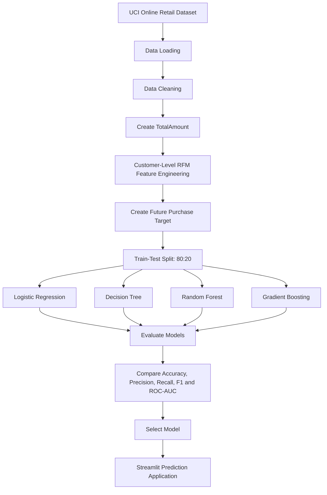

# Smart Customer Purchase Prediction Using Machine Learning

## Project Workflow

## Main Methodology Steps

1. **Data collection:** Obtain the Online Retail dataset from the UCI Machine Learning Repository.
2. **Data preprocessing:** Remove duplicate transactions, records with missing customer IDs, non-positive quantities and non-positive prices.
3. **Feature engineering:** Calculate transaction amount and generate Recency, Frequency and Monetary customer features.
4. **Target creation:** Label customers according to whether they purchase during the final 30-day period.
5. **Model training:** Train four supervised classification algorithms using an 80:20 stratified train-test split.
6. **Model evaluation:** Compare accuracy, precision, recall, F1 Score and ROC-AUC.
7. **Feature analysis:** Use permutation importance to examine the influence of customer features.
8. **Application development:** Use Streamlit to provide an interface for purchase predictions and model analysis.
